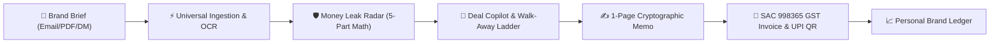

<div align="center">

  

  # Kreato

  ### The Creator Business Platform & Income Defense Copilot
  *Protecting Indian creators' income before they say yes to brand deals, then automating follow-through until they are paid.*

  <br />

  [](http://kreato-beta.vercel.app/)
  [](https://nextjs.org/)
  [](https://www.typescriptlang.org/)
  [](https://supabase.com/)
  [](https://ai.google.dev/)
  [](https://vitest.dev/)

  <br />

  **[🌐 Explore Live Application](http://kreato-beta.vercel.app/)** • **[📖 Architecture Docs](docs/ARCHITECTURE.md)** • **[🚀 Feature Guide](docs/FEATURES.md)** • **[📊 Database Schema](docs/DATABASE.md)**

</div>

---

## 🌟 Overview

Independent creators operate as modern businesses, yet negotiate blindly against agencies with uncompensated perpetual usage rights, 60-day delayed payment terms, and 40%–70% below-market rates.

**Kreato** replaces chaotic WhatsApp messages, Instagram DMs, and confusing brand email threads with an **enterprise-grade commercial engine** built specifically for Indian creators.



---

## ✨ Key Features

### 🛡️ 1. Money Leak Radar
* **Deterministic 5-Part Mathematical Engine**: Identifies hidden financial risks before accepting terms:
  * **Rate Benchmark Gap**: Compares fees against 240 Indian creator market medians.
  * **Perpetual Usage Rights**: Identifies uncompensated ad whitelisting and perpetual licenses.
  * **Payment Delay Cost**: Computes financing cost for Net-45/60/90 delayed terms at an 18% annual capital rate.
  * **Exclusivity Lockout**: Flags uncompensated category lockouts that block future revenue.
  * **Brand Track Record Risk**: Integrates past settlement delays from your Brand Ledger.

### 🎯 2. Deal Copilot & 3-Tier Walk-Away Ladder
* **Anchor, Target, Floor**: Calculates non-negotiable boundaries so you never settle below fair market value.
* **Assertive Counter-Offer Drafting**: Powered by **Google Gemini 3.8 Flash**, crafting professional counter-emails tailored to Indian brand agencies.
* **Separation of Concerns**: Strict boundary distinguishing AI suggestions from confirmed commercial obligations.

### ✍️ 3. Frictionless 1-Page Deal Memos
* **One-Click Brand Sign-off**: Generates a shareable, responsive 1-page agreement summary.
* **Cryptographic 32-Byte Token**: Brand leads can review and sign terms with zero sign-up or login friction.
* **Immediate Transition**: Deal automatically advances from `pitch` to `agreed` upon digital confirmation.

### 🧾 4. SAC 998365 GST Tax Invoicing & Instant UPI
* **Indian Tax Compliance**: Automated integer paise calculations for CGST (9%) + SGST (9%) or inter-state IGST (18%).
* **Sequential Financial Year Numbering**: Compliant with Indian tax formats (e.g., `DS/2026-27/001`).
* **NPCI-Compliant Dynamic UPI QR**: Instant scan-and-pay via PhonePe, Google Pay, and Paytm directly from the invoice PDF.

### 📊 5. Personal Brand Ledger
* **Creator Credit Memory**: Private scorecard analyzing brand settlement habits.
* **Track Record Metrics**: Flags repeat late payers, average payment settlement days, and total lifetime revenue.

### 📬 6. Universal Ingestion & Inbox Radar
* **Gmail REST API Integration**: Ingests incoming brand pitches directly from your collaboration inbox.
* **On-Device OCR Engine**: Extracts commercial rates and deliverable terms from PDF briefs and image screenshots.
* **Scam Shield**: Proactively detects pay-to-collab scams, impersonation domains, and prompt injection traps.

---

## 🛠️ Tech Stack

| Layer | Technology | Details |
| :--- | :--- | :--- |
| **Framework** | **[Next.js 14](https://nextjs.org/)** | App Router, Server Actions, Route Handlers, Edge Middleware |
| **Language** | **[TypeScript 5.7](https://www.typescriptlang.org/)** | Strict type-safety across client and server |
| **Styling** | **[Tailwind CSS 3.4](https://tailwindcss.com/)** | Modern responsive design with custom pastel palette |
| **Components** | **[Radix UI](https://www.radix-ui.com/)** | Unstyled, accessible UI primitives |
| **Animations** | **[Framer Motion 11](https://www.framer.com/motion/)** | Layout text flip, floating showcase cards, spring animations |
| **Database** | **[Supabase PostgreSQL](https://supabase.com/)** | Row-Level Security (RLS), ACID transactions, UUID keys |
| **Auth** | **[Supabase SSR](https://supabase.com/docs/guides/auth/server-side/nextjs)** | Cookie-based PKCE authentication & Google OAuth 2.0 |
| **AI / LLM** | **[Google Gemini 3.8 Flash](https://ai.google.dev/)** | Deal brief extraction, counter-offers, payment watchdog |
| **Invoicing** | **[@react-pdf/renderer](https://react-pdf.org/)** | Server/client PDF compilation with GST layout |
| **Payments** | **[QRCode](https://github.com/soldair/node-qrcode)** | Dynamic UPI QR code generation |
| **OCR** | **[Tesseract.js](https://tesseract.projectnaptha.com/)** | Client-side OCR for rate cards and briefs |
| **Testing** | **[Vitest 2.1](https://vitest.dev/)** & **[Playwright](https://playwright.dev/)** | Unit, integration, and E2E test suites |
| **Hosting** | **[Vercel](https://vercel.com/)** | Edge runtime deployed in `bom1` (Mumbai, India) |

---

## 🚀 Quickstart & Local Setup

### 1. Clone & Install Dependencies
```bash
git clone https://github.com/Jagadish-s-naik/kreato.git
cd kreato
npm install
```

### 2. Configure Environment Variables
Copy `.env.example` to `.env.local`:
```bash
cp .env.example .env.local
```

Fill in your configuration keys:
```env
# Supabase Configuration
NEXT_PUBLIC_SUPABASE_URL=https://your-project.supabase.co
NEXT_PUBLIC_SUPABASE_ANON_KEY=your-supabase-anon-key
SUPABASE_SERVICE_ROLE_KEY=your-supabase-service-role-key

# Google Gemini API
GEMINI_API_KEY=your-gemini-api-key
GEMINI_MODEL=gemini-3.8-flash

# Base URL
APP_URL=http://localhost:3000
APP_DOMAIN=localhost:3000

# Google OAuth & Gmail Integration
GOOGLE_OAUTH_CLIENT_ID=your-google-oauth-client-id
GOOGLE_OAUTH_CLIENT_SECRET=your-google-oauth-client-secret
GOOGLE_OAUTH_REDIRECT_URI=http://localhost:3000/api/gmail/callback
TOKEN_ENCRYPTION_KEY=your-32-byte-base64-key
```

### 3. Run Database Migrations & Seed Data
In your Supabase SQL Editor, run:
1. `supabase/migrations/001_init.sql` *(Schema, tables, RLS policies)*
2. `supabase/migrations/002_google_integrations.sql` *(Gmail & YouTube tokens)*
3. `supabase/seed.sql` *(240 creator rate benchmarks across 12 niches)*

### 4. Start Development Server
```bash
npm run dev
```
Open **[http://localhost:3000](http://localhost:3000)** in your browser.

---

## 🧪 Testing & Quality Assurance

Kreato features complete test coverage for financial formulas, tax calculations, and database security:

```bash
# Run all unit test suites
npm test

# Run TypeScript compilation check
npm run typecheck

# Run Playwright E2E browser tests
npm run test:e2e
```

### Test Suite Summary:
* ✅ **16 passed test files** (75 unit tests)
* ✅ RLS authorization policies verified
* ✅ Integer paise math validated (zero floating-point drift)
* ✅ Prompt injection and scam detection tested
* ✅ RFC 5545 iCalendar serialization verified

---

## 📁 Repository Architecture

```text
kreato/
├── app/
│   ├── (marketing)/         # Public landing page, login, signup, forgot-password
│   ├── dashboard/           # Creator business headquarters & deal pipeline preview
│   ├── inbox/               # Deal ingestion, OCR brief scanner, Gmail sync
│   ├── deals/               # Kanban pipeline & single deal workspace [id]
│   ├── radar/               # 5-part Money Leak Radar engine & benchmarks
│   ├── contracts/           # Deal Memo generator & client review links
│   ├── invoices/            # SAC 998365 GST tax invoices & UPI QR codes
│   ├── ledger/              # Personal Brand Ledger scorecards & reliability
│   ├── memo/[token]/        # Public frictionless client review & signature
│   ├── api/                 # Next.js Serverless Route Handlers
│   └── layout.tsx           # Root application shell
├── backend/
│   ├── services/            # Business logic (deal, memo, invoice, audit, llm)
│   └── supabase/            # Client, server, and service-role database wrappers
├── frontend/
│   ├── components/          # Modular React components (marketing, auth, layout)
│   ├── styles/              # Global Tailwind CSS and design tokens
│   └── lib/                 # Frontend utility helpers and formatters
├── lib/                     # Pure deterministic engines (radar, ladder, gst, scam)
├── supabase/
│   ├── migrations/          # SQL database migrations
│   └── seed.sql             # 240 Indian creator rate benchmarks
└── docs/                    # Full engineering and architectural documentation
```

---

## 📄 License & Attribution

Built for independent content creators. Built with Next.js, Supabase, and Google Gemini.
Distributed under the MIT License. See `LICENSE` for details.
