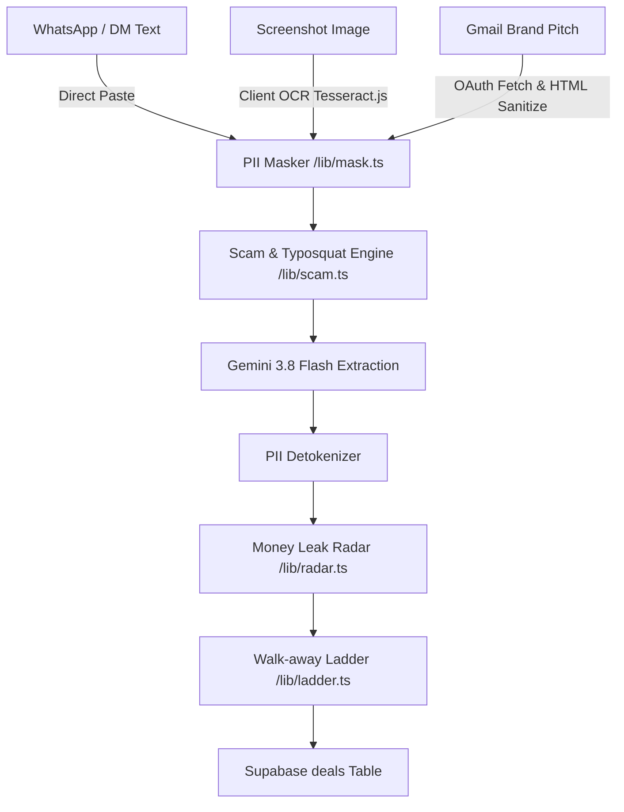

# Architecture & Technical Design — Kreato

This document defines the system architecture, directory boundaries, data flows, LLM wrapper design, Google service integrations, and reliability strategies for Kreato.

---

## 1. Directory Structure & Module Boundaries

The codebase strictly enforces modular isolation across presentation, backend infrastructure, and deterministic domain calculations.

```
kreato/
├── frontend/                     # PRESENTATION LAYER (Client components, hooks, styles)
│   ├── components/               # React UI components
│   │   ├── inbox/                # Text paste, Tesseract OCR runner, Gmail search table
│   │   ├── copilot/              # Deal card, risky quote chips, banner alerts
│   │   ├── radar/                # Framer Motion animated counter & line-item breakdowns
│   │   ├── ladder/               # Ideal/Acceptable/Walk-away cards & trigger buttons
│   │   ├── memo/                 # Deal Memo viewer & @react-pdf/renderer template
│   │   ├── invoice/              # GST invoice viewer, @react-pdf/renderer & UPI QR code
│   │   ├── calendar/             # Calendar export button group (.ics & Google Calendar links)
│   │   └── ui/                   # Atomic UI elements (button, dialog, input, card, badge)
│   ├── hooks/                    # Client hooks (useOCR, useCanvasRedaction, useClock)
│   ├── styles/                   # Tailwind CSS setup & globals.css
│   └── lib/                      # Frontend UI helpers (e.g. cn merge utility)
│
├── backend/                      # BACKEND SERVICES, APIs & DATA PIPELINES (Server-only)
│   ├── api/                      # Next.js App Router Route Handlers (app/api/)
│   ├── services/                 # Server-side business services
│   │   ├── llm.service.ts        # Gemini API orchestrator, prompt builders, schema validators
│   │   ├── deal.service.ts       # Deal lifecycle manager & Personal Brand Ledger queries
│   │   ├── memo.service.ts       # Token generation, SHA-256 hashing & verification
│   │   ├── invoice.service.ts    # Sequential FY invoice generation & settlement logging
│   │   ├── youtube.service.ts    # YouTube Data API v3 channels.list & 24hr caching
│   │   ├── gmail.service.ts      # OAuth 2.0 PKCE, AES-256-GCM token encryption, search & fetch
│   │   ├── audit.service.ts      # Append-only audit logging helper
│   │   └── rate-limit.service.ts # ai_usage rate-limiter (20 req / 10 min)
│   └── supabase/                 # Database clients
│       ├── server.ts             # User-authenticated client via @supabase/ssr
│       └── service.ts            # Service-role client (memo verification, encrypted tokens)
│
├── lib/                          # PURE DETERMINISTIC ENGINES (No React, No Supabase, No LLM)
│   ├── calendar/
│   │   └── ics.ts                # RFC 5545 .ics generator (UTF-8 safe folding, exclusive end dates)
│   ├── youtube/
│   │   ├── parser.ts             # URL and @handle parser with hostname allowlist
│   │   └── mapper.ts             # Deterministic subscriber-to-follower-band mapper
│   ├── gmail/
│   │   ├── relevance.ts          # Deterministic keyword/header heuristics for brand pitches
│   │   └── sanitizer.ts          # HTML-to-plain-text stripper (scripts, tracking pixels, quotes)
│   ├── config/
│   │   ├── app.ts                # Application branding & constants
│   │   ├── bands.ts              # Follower band subscriber thresholds
│   │   └── radar.ts              # Radar rates (15d baseline, 18% annual financing, 2% risk blocks)
│   ├── types/                    # Zod schemas & inferred TypeScript types
│   ├── radar.ts                  # Money Leak Radar: benchmark gap, usage %, delay cost, exclusivity
│   ├── ladder.ts                 # Walk-away Ladder tier calculations
│   ├── scam.ts                   # Rule engine: pay-to-collab, lookalikes, injection patterns
│   ├── exclusivity.ts            # Overlapping campaign and category conflict engine
│   ├── gst.ts                    # Sequential FY numbering, CGST/SGST vs IGST calculation
│   ├── upi.ts                    # upi://pay URI generator and QR code builder
│   ├── mask.ts                   # PII tokenization (phone, email, UPI, PAN, GSTIN)
│   ├── dates.ts                  # Indian Financial Year calculation & credit terms
│   └── clock.ts                  # Virtual clock offset calculation (sim_days_offset)
```

---

## 2. Ingestion Pipeline & Channel Normalization

All three capture channels normalize into a unified deal representation before radar analysis:



---

## 3. Google Integrations Architecture (Features 12, 13, 14)

### A. Calendar Export (Feature 12)
- **Zero OAuth**: Generates downloadable RFC 5545 standard `.ics` files and pre-encoded web template links (`https://calendar.google.com/calendar/render?action=TEMPLATE...`).
- **Formatting**: Strict CRLF line terminators; UTF-8 safe line folding at 75 octets; all-day events using exclusive end dates (`DTEND;VALUE=DATE`).
- **Stable Identifiers**: Unique `UID: <entity>-<id>-<type>@<APP_DOMAIN>` prevents duplicate entries when re-downloaded.

### B. YouTube Channel Stats (Feature 13)
- **API Key Only**: Calls `https://www.googleapis.com/youtube/v3/channels` with `part=snippet,statistics` using server-side `YOUTUBE_API_KEY`.
- **Validation**: Strict hostname allowlist (`youtube.com`, `www.youtube.com`, `m.youtube.com`) and handle regex.
- **Cache**: Stores results in `youtube_links` table with 24-hour cache validity.

### C. Gmail Import Beta (Feature 14)
- **OAuth 2.0 PKCE**: Authorization Code flow with PKCE (`code_challenge` / `code_verifier`) and state verification in `httpOnly`, `Secure` cookie.
- **Restricted Scope**: Requests strictly `https://www.googleapis.com/auth/gmail.readonly`.
- **Encryption**: AES-256-GCM encryption with 12-byte IV using `TOKEN_ENCRYPTION_KEY`. Tokens stored in `gmail_connections` with zero client-facing RLS policies.
- **Deduplication**: Hashes Google message IDs into `deals.source_ref = SHA-256(message_id)`.
